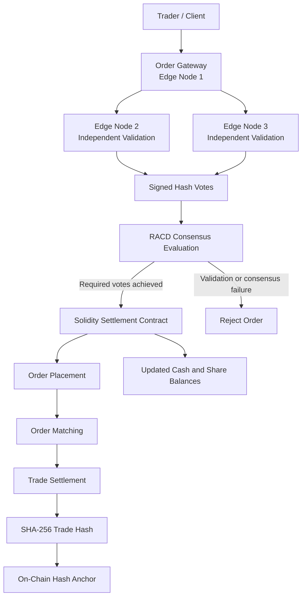

<div align="center">

# BlockExDSE

### A Permissioned, Edge-Assisted Blockchain Architecture for Stock Exchange Order Processing and Settlement

**Bringing Risk-Adaptive Consensus to Blockchain-Based Financial Systems**

<p>
  
  
  
  
</p>

**Developed as a Capstone Project at the University of Liberal Arts Bangladesh (ULAB)**

[Explore the Repository](https://github.com/whiteSoulX/BlockExDSE-) · [Report an Issue](https://github.com/whiteSoulX/BlockExDSE-/issues)

</div>

---

## Overview

**BlockExDSE** is a research prototype that combines edge computing and permissioned blockchain technology to support stock exchange order validation, matching, and settlement.

Traditional blockchain-based exchange designs may send every order through the same validation and consensus process, regardless of its risk level. This can consume unnecessary ledger capacity and provide insufficient differentiation between routine and potentially risky transactions.

BlockExDSE explores a different approach: **validate orders at the edge and adapt the required level of agreement to the order's risk.**

The proposed mechanism, **Risk-Adaptive Consensus Depth (RACD)**, uses three edge nodes to validate orders independently and exchange signed hash votes. Routine orders require agreement from at least two of three nodes, while higher-risk orders require agreement from all three.

Only orders that satisfy the required checks proceed to the Solidity settlement contract.

The prototype has been implemented and tested on a local Hardhat blockchain network. All 11 automated end-to-end checks passed. Performance measurements for throughput, latency, and energy consumption remain future work.

> **Project scope:** BlockExDSE is an experimental research prototype, not a production-ready stock exchange or a deployment approved for real financial transactions.

---

## Key Features

| Feature | Description |
|---|---|
| Edge-assisted validation | Three edge nodes independently validate submitted orders before blockchain processing. |
| Risk-Adaptive Consensus Depth (RACD) | Adjusts the required number of agreeing edge nodes according to the order's risk score. |
| Signed hash voting | Uses signed order-hash votes to verify agreement between edge validators. |
| Permissioned access | Restricts order submission through registered participants and authorized addresses. |
| Smart contract settlement | Uses Solidity contracts to record orders and update simulated cash and share balances. |
| Order matching | Supports price-priority matching and partial fills in the prototype. |
| On-chain hash anchoring | Stores SHA-256 hashes of trade records on the blockchain for integrity verification. |
| Automated verification | Includes 11 end-to-end checks covering order processing, settlement, and faulty-node behaviour. |
| Monitoring dashboard | Provides a view of the order pipeline, node health, order book, and on-chain balances. |

---

## System Architecture

BlockExDSE follows a three-layer architecture.



### Layer 1 — Edge Validation

The gateway receives an order and coordinates independent validation by three edge nodes.

The validation process checks:

- Participant registration and KYC status.
- Supported ticker and order side.
- Positive order quantity and price.
- Compliance with the configured price-deviation limit.
- Agreement between signed order hashes and validator identities.

Invalid orders can be rejected before they reach the settlement contract.

### Layer 2 — Risk-Adaptive Consensus

RACD determines the required level of agreement using the order's value and its deviation from a reference price.

| Order category | Required agreement | Behaviour |
|---|---|---|
| Standard | 2 of 3 edge nodes | Allows routine orders to proceed when at least two valid votes agree. |
| Escalated | 3 of 3 edge nodes | Requires unanimous agreement for higher-risk orders. |

The purpose is to allocate validation effort according to risk rather than applying the same consensus threshold to every order.

### Layer 3 — Blockchain Settlement

Orders that pass the edge checks and required voting threshold are submitted to the Solidity contract.

The prototype supports:

1. Order placement.
2. Price-priority matching.
3. Partial and completed fills.
4. Cash and share balance updates.
5. SHA-256 hash anchoring of trade records.

The blockchain provides the settlement state and a tamper-evident record of anchored trade hashes.

---

## Risk-Adaptive Consensus Depth (RACD)

RACD is the central mechanism proposed in BlockExDSE.

The prototype calculates an order risk score using order value and relative price deviation.

Let:

- \(N\) = order value in BDT.
- \(d\) = absolute relative deviation from the reference price.

The score is:

\[
R = 0.5\min\left(\frac{N}{500000},1\right)
+ 0.5\min\left(\frac{d}{0.10},1\right)
\]

The consensus rule is:

\[
\text{Required votes} =
\begin{cases}
2, & R < 0.5 \\
3, & R \geq 0.5
\end{cases}
\]

The score weights and thresholds are initial design parameters and have not yet been experimentally optimized.

### Why RACD?

A fixed consensus threshold treats routine and risky orders similarly. RACD explores whether risk-based thresholds can improve validation behaviour while preserving stronger checks for orders that require additional scrutiny.

In the prototype's faulty-node test:

- A standard order passed with two agreeing votes when one node returned a corrupted hash.
- An escalated order was rejected under the same faulty-node condition.
- After the faulty node was restored, the escalated order passed with three agreeing votes.

These results demonstrate the intended behaviour in the local test environment. They do not establish production-grade Byzantine fault tolerance or measured performance improvements.

---

## Technology Stack

| Technology | Role |
|---|---|
| Solidity 0.8.20 | Smart contracts for order processing and settlement. |
| Hardhat 2 | Local Ethereum-compatible development and testing environment. |
| FastAPI | Edge-node and gateway API services. |
| web3.py | Python interaction with the blockchain. |
| Python | Order validation, consensus coordination, and testing logic. |
| MongoDB | Optional persistence for application data. |
| SHA-256 | Trade-record hash generation and integrity anchoring. |
| HTML, CSS, JavaScript | Web-based monitoring dashboard. |

The prototype was tested against a local Hardhat network using chain ID `31337`.

---

## Test Results

The prototype was evaluated using an automated end-to-end test script.

**Result: 11 out of 11 checks passed.**

| Test area | Verified behaviour |
|---|---|
| Order placement | Valid orders can be placed. |
| Order matching | Crossing orders are matched. |
| Price priority | The resting order's price is used in the tested matching scenario. |
| Partial fills | Remaining quantities are handled correctly. |
| Trade settlement | Cash and share balances are updated. |
| Hash anchoring | Trade-record hashes are stored on-chain. |
| Price validation | Orders outside the configured price band are rejected at the edge. |
| Participant validation | Orders from unregistered participants are rejected. |
| Standard consensus | A standard order passes with two valid votes when one node is faulty. |
| Escalated consensus | An escalated order is rejected when only two of three votes agree. |
| Recovery | The escalated order passes after all three nodes provide valid votes. |

The settlement contract was deployed using **1,267,724 gas** in the reported local environment.

### What these results establish

The tests demonstrate that the implemented components work together and that the RACD decision rules behave as intended in the tested scenarios.

They do not establish:

- Higher transaction throughput.
- Lower end-to-end latency.
- Lower total energy consumption.
- Production-level security.
- Scalability under realistic trading loads.

These require additional experiments and evaluation.

---

## Getting Started

### Prerequisites

Before running the project, ensure that your environment has the dependencies required by the repository:

- Python with the required application packages.
- Node.js and npm.
- Hardhat and the project's JavaScript dependencies.
- A local blockchain development environment.
- MongoDB, if persistent storage is enabled.

### Installation

Clone the repository:

```bash
git clone https://github.com/whiteSoulX/BlockExDSE-.git
cd BlockExDSE-
```

Install the dependencies using the package manifests provided in the repository.

For a Python environment, the typical workflow is:

```bash
python -m venv .venv
```

Activate the environment and install the packages listed in the project's Python dependency file.

For a Hardhat project, install the JavaScript dependencies:

```bash
npm install
```

### Running the Prototype

Start the local blockchain, launch the edge services, and start the application using the project's provided launcher and configuration.

Run the automated end-to-end test script to verify order validation, consensus, matching, settlement, and hash anchoring.

> **Important:** The exact launcher, test command, and dependency-file names must match the current repository. Confirm them from the project files before using this section as a definitive installation guide.

---

## Research Motivation

The project investigates the intersection of three areas:

**1. Edge Computing**

Moves suitable validation and preprocessing tasks closer to the point where orders enter the system.

**2. Permissioned Blockchain**

Provides a shared settlement state and an auditable record of anchored trade hashes.

**3. Risk-Adaptive Consensus**

Explores whether requiring different levels of validator agreement for different risk categories can improve how orders are screened.

The central research question is:

> Can edge nodes screen stock exchange orders and adapt the required level of agreement to order risk before blockchain settlement, while maintaining correct order-processing behaviour?

BlockExDSE provides a functional prototype for investigating this question.

---

## Current Limitations

The current implementation is a proof of concept, with several limitations.

- **Centralized gateway:** Order relaying relies on a single authorized administrator address.
- **Limited deployment environment:** The three edge nodes were tested on one machine.
- **No performance evaluation:** Throughput, latency, gas per order, and energy consumption have not been systematically measured.
- **Initial risk parameters:** RACD weights and thresholds have not been tuned against realistic market data.
- **Privacy limitations:** A dedicated privacy-preserving layer has not been implemented.
- **Market-execution risks:** Front-running and other maximal extractable value (MEV) attacks are not yet addressed.
- **Simulated market:** Traders, balances, and prices are simulated rather than taken from a live exchange.
- **No public-testnet evaluation:** The prototype has not yet been evaluated across separate machines on a public testnet.

These limitations define the scope of future development and prevent the current results from being interpreted as evidence of production readiness.

---

## Future Work

The next stages of research and development are:

1. **Performance benchmarking:** Measure throughput, latency, gas consumption per order, and energy use.
2. **Baseline comparison:** Compare RACD against a fixed 2-of-3 voting rule under equivalent test conditions.
3. **Distributed deployment:** Run edge nodes on separate machines and evaluate network delays and failure scenarios.
4. **Validator governance:** Replace the single-admin relay with a properly implemented validator committee and leader-failover mechanism.
5. **Risk-score optimization:** Evaluate RACD thresholds using representative order data.
6. **Privacy and fairness:** Investigate privacy-preserving trading and defences against front-running.
7. **Testnet evaluation:** Validate the prototype in a broader blockchain environment.

---

## Project Team

Developed by the BlockExDSE capstone research team at the University of Liberal Arts Bangladesh.

| Team member | Research contribution |
|---|---|
| Prisom Halder | Blockchain stock-exchange feature analysis and findings. |
| Sima Akter Tithi | Edge-computing framework adaptation. |
| Muskan Gouri | Energy-efficiency research for edge placement. |
| Md. Minhaz Hossen | Integration of research findings and identification of the research gap. |

**Supervisor:** Nafees Mansoor, PhD

---

## Academic Context

BlockExDSE is an experimental project exploring edge-assisted blockchain architecture for stock-exchange order processing and settlement, with the Dhaka Stock Exchange as its motivating application context.

Its primary contribution is the implementation and functional testing of Risk-Adaptive Consensus Depth in an edge-assisted settlement prototype.

The current findings support the feasibility of implementing the proposed workflow. Further experimental evidence is needed to determine its performance, energy efficiency, scalability, and security.

---

## Contributing

Contributions, suggestions, and technical feedback are welcome.

If you want to contribute:

1. Fork the repository.
2. Create a feature branch.
3. Implement and test your changes.
4. Submit a pull request describing the change.

For bugs, questions, or feature suggestions, use the repository's [Issues](https://github.com/whiteSoulX/BlockExDSE-/issues) page.

---

## License

A license has not been specified in this README draft. Add the appropriate license after confirming the project's intended distribution terms.

---

<div align="center">

### BlockExDSE

**Risk-aware validation. Edge-assisted processing. Blockchain-based settlement.**

*An experimental step toward more adaptive blockchain architectures for financial systems.*

[Back to Repository](https://github.com/whiteSoulX/BlockExDSE-)

</div>
